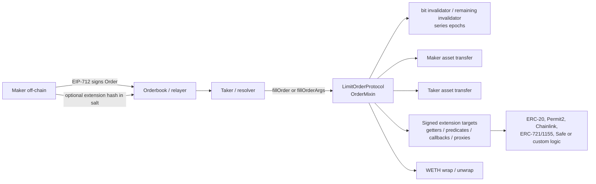
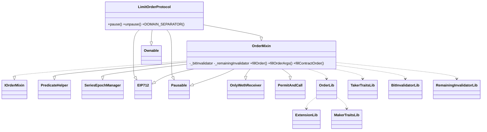
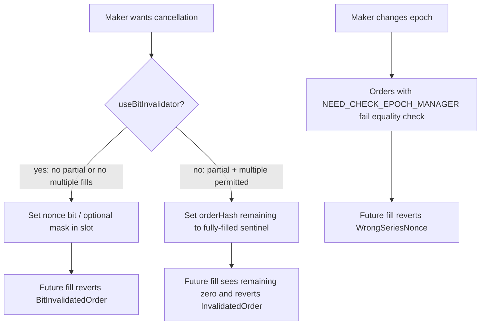

# System architecture

## Facts from the checked-out code

`LimitOrderProtocol` is a small concrete shell over `OrderMixin` (`contracts/LimitOrderProtocol.sol:31-58`). It adds an OpenZeppelin EIP-712 domain named **1inch Limit Order Protocol**, version **4**, owner-only pause/unpause, and a WETH address passed into `OrderMixin`. The economic/state-machine behavior is in `contracts/OrderMixin.sol`.

The system is deliberately split between an immutable, maker-signed **order** and optional maker-signed **extension bytes**. The order embeds only the low 160 bits of `keccak256(extension)` in `salt`; the actual extension is supplied by the filler. Consequently, an untrusted relayer may carry the bytes but cannot substitute them except with an infeasible 160-bit hash collision (`contracts/OrderLib.sol:175-183`).



### Inheritance and dependency graph



### Storage and authority

| Location | State | Who changes it | Invariant / consequence |
|---|---|---|---|
| `OrderMixin:40` | `_bitInvalidator[maker][slot]` | Any caller only for its own `msg.sender` through cancel functions; fill marks the order maker's bit. | A set bit permanently prevents that nonce's fill. |
| `OrderMixin:41` | `_remainingInvalidator[maker][orderHash]` | Fill or a caller cancelling only as `msg.sender`. | `0` means never filled; complement encoding represents a remaining amount. |
| `SeriesEpochManager:21` | packed maker/series epoch | Maker calling `advanceEpoch` / `increaseEpoch`. | Orders flagged for epoch checks require equality. |
| OpenZeppelin `Ownable` / `Pausable` | owner and paused bit | LOP deployer/owner. | Owner can stop fills, but cancellation functions are not paused. |
| Helper/extension immutables | LOP, WETH, Permit2, access token, factory | Constructor/deployment. | Wrong per-chain construction is a material integration risk. |

## Off-chain creation and signing

The maker constructs the eight-word static `IOrderMixin.Order` and chooses `MakerTraits`. The EIP-712 hash is `keccak256("\\x19\\x01" || domainSeparator || keccak256(typehash || order))` (`OrderLib.sol:33-66`). OpenZeppelin's `EIP712` domain binds chain ID and verifying contract. The standard LOP domain is bound to the LOP address; the native-order helpers intentionally use `EIP712Alien` to bind their domain to the LOP while executing in a clone.

```mermaid
sequenceDiagram
  participant M as Maker
  participant U as Off-chain utility
  participant R as Relayer
  participant L as LimitOrderProtocol
  M->>U: order fields + maker traits + optional extension
  U->>U: extensionHash = keccak256(extension)[159:0]
  U->>U: salt embeds extensionHash; EIP-712 hash uses LOP domain
  M->>U: EOA compact signature, or contract-maker approval
  U->>R: order, signature, extension (if any)
  R->>L: filler later submits the exact signed material
  L->>L: recompute domain-bound order hash and extension binding
```

## Fill execution, ordering, and trust boundaries

The exact basic EOA path is `_fillOrder` then `_fill` in `OrderMixin.sol:159-441`. Signature verification occurs only on the first fill; subsequent fills rely on the state invalidator. Before *any* extension callback or asset transfer, `_fill` validates the extension, sender, expiry, epoch, predicate, amounts, and writes the invalidator (`OrderMixin.sol:273-342`). This checks-effects-interactions ordering is a central replay/reentrancy defense.

```mermaid
sequenceDiagram
  participant T as Taker
  participant L as LOP / OrderMixin
  participant S as Invalidator state
  participant P as Predicate / Getter
  participant Pre as Maker pre-callback
  participant MA as Maker asset / proxy
  participant I as Taker interaction
  participant TA as Taker asset / proxy
  participant Post as Maker post-callback
  T->>L: fillOrder[Args](order, signature, amount, traits, args)
  L->>L: hash; first-fill signature and optional maker permit
  L->>P: extension validation, predicate, dynamic amount getter
  L->>S: mark bit or remaining amount
  L->>Pre: optional preInteraction
  L->>MA: maker -> target transfer; optional WETH unwrap
  L->>I: optional takerInteraction
  L->>TA: taker -> receiver transfer; optional ETH/WETH conversion
  L->>Post: optional postInteraction
  L-->>T: OrderFilled(orderHash, remaining)
```

The relevant external-call trust boundaries are: token `transferFrom` implementations (or selector-compatible proxies); Permit2; WETH; arbitrary static predicate targets; dynamic amount getters; pre/taker/post interaction targets; and recipient ETH fallbacks. Most are selected by maker-signed data; the taker chooses only its encoded `target`, interaction bytes, and limit/amount mode. A valid signed order therefore delegates substantial policy to its maker, not to the protocol.

## Cancellation model



The bit path is intentionally broad: `cancelOrder` uses only the supplied traits to decide the mechanism, so its supplied hash is ignored for bit orders. The caller is nevertheless `msg.sender`, so it can affect only that caller's invalidator bitmap (`OrderMixin.sol:80-88`).

## Deployment architecture

Hardhat deploy scripts are disabled by default (`module.exports.skip = async () => true`). Deployments pull WETH/router/access-token/Create3 addresses and salts from `config/constants.json`, use Create3 except on zkSync, and expose helper contracts independently. `NativeOrderFactory` deploys a single `NativeOrderImpl` then uses deterministic minimal-proxy clones seeded by the original maker order hash (`NativeOrderFactory.sol:41-66`). A factory's owner can recover only funds held by the factory itself, not clone escrow.

The repository's checked-in deployment manifests are historical/output records. They must be cross-checked with constructor arguments and chain bytecode before relying on them in a production review.
