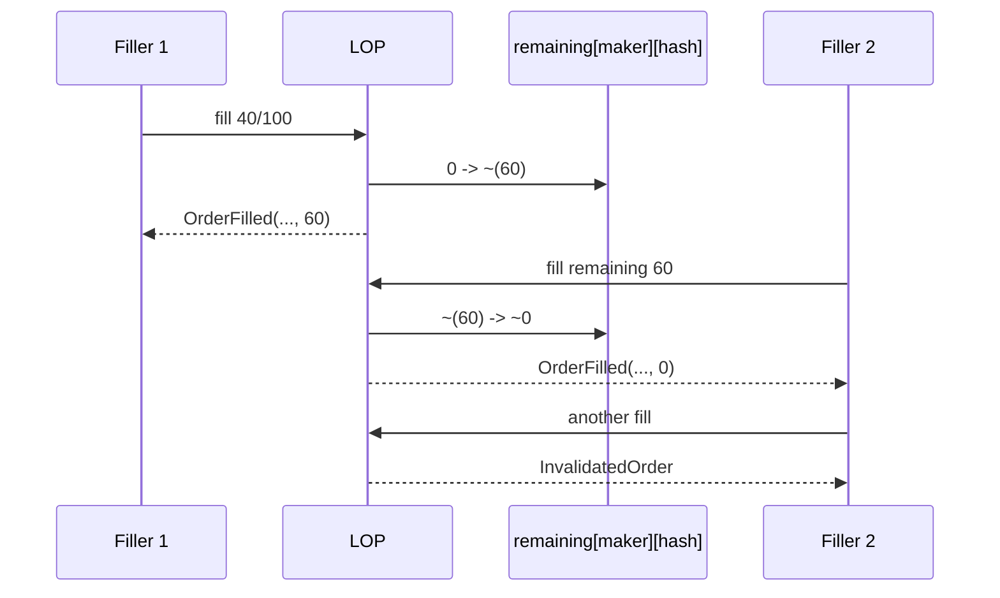
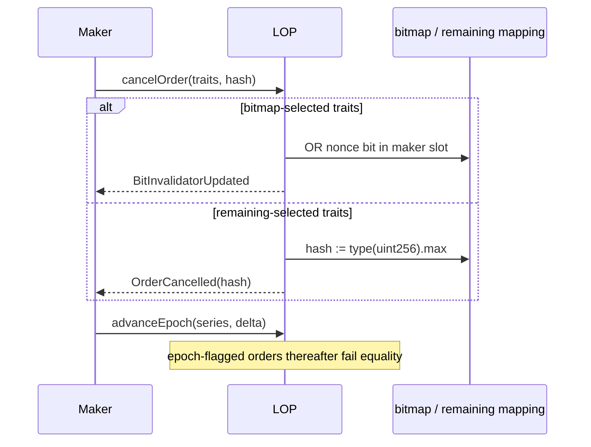
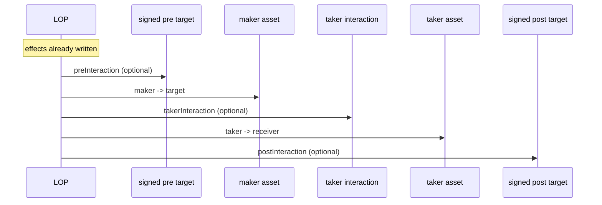

# Execution traces

## A. Basic EOA order

1. The maker signs the `OrderLib.hash` EIP-712 digest off-chain (`contracts/OrderLib.sol:55-66`).
2. A taker calls `fillOrder` or `fillOrderArgs`; the latter decodes optional target, extension, and interaction using declared taker-trait lengths (`contracts/OrderMixin.sol:129-157`, `451-480`).
3. `_fillOrder` hashes, finds the initial remaining amount, and on a first fill requires the recovered signer to equal nonzero maker (`159-188`).
4. `_fill` runs all order validation and amount computation, then records state before external work (`263-342`).
5. It transfers maker asset, invokes optional taker interaction, takes payment, invokes optional post interaction, and emits `OrderFilled` (`344-440`).

Failure points: bad compact signature, invalid extension hash, private sender mismatch, expiry, incorrect epoch, false predicate, price threshold, zero amount, insufficient allowance/balance, callback/token failure, or ETH recipient failure. All of these revert the full transaction.

## B. Partial / multi-fill order

Only traits with partial fills allowed **and** multiple fills allowed use `_remainingInvalidator`. The first call reads `order.makingAmount`, calculates an amount not exceeding it, and stores `~(remaining-making)` (`OrderMixin.sol:490-497`; `RemainingInvalidatorLib.sol:51-70`). The next call skips signature verification, reads the updated remainder, and repeats. A final fill stores all ones, which decodes to zero and makes later fills revert `InvalidatedOrder`.

The `NO_PARTIAL_FILLS` check compares making amount to the *original* maker amount, so a partially computed result always fails for a no-partial order. A bitmap order is marked during the first successful fill, enforcing one fill irrespective of its requested amount.

## C. Invalid, expired, or malformed order

Extension absence/presence/hash mismatch is rejected first in `_fill` through four-byte custom-error bubbling (`OrderMixin.sol:273-283`). Expiry uses strict `< block.timestamp` (`MakerTraitsLib.sol:83-86`), so an order is valid at exactly its expiration timestamp. For `fillOrderArgs`, short malformed user-supplied args can fail Solidity slicing before extension validation; that is a self-inflicted failed transaction, not a state change. Predicates execute through `staticcall`, accepting only exact 32-byte result `1` (`PredicateHelper.sol:76-86`).

## D. Cancellation and invalidation

`cancelOrders` enforces matching array length. `bitsInvalidateForOrder` requires bitmap-compatible traits and can invalidate a supplied mask in the same 256-order slot (`OrderMixin.sol:93-109`). A cancellation does not validate that traits/hash form a previously signed order; it need not, because its effects are scoped to `msg.sender` and cancellation is intentionally permissionless for one's own namespace.

## E. Extension order

The filler supplies exact extension bytes through args. `ExtensionLib` slices maker/taker suffixes, getter payloads, predicate, permit, callbacks, and custom data from packed offsets (`contracts/libraries/ExtensionLib.sol:16-132`). Amount getter target/data is maker-bound by extension hash; predicate is evaluated before state mutation; callback targets execute after state mutation. Therefore the extension is a maker-selected programmable order policy, while the taker remains protected only by price threshold and normal transaction atomicity.

## F. Callback order and reentrancy

The protocol does not use a global non-reentrancy modifier because callbacks support composing fills (see `RecursiveMatcher` tests). Safety instead relies on the write-before-call invariant. A nested remaining order sees its reduced amount. Any inner or outer revert rolls the transaction back atomically. Integrators must treat the callbacks and token contracts as arbitrary code and should not assume an order is single-threaded beyond its invalidator semantics.

## G. Native asset and token modes

Maker WETH can be delivered as ETH only if the taker sets `unwrapWeth`; taker WETH can be paid as ETH only if `msg.value` is nonzero and sufficient. Excess `msg.value` is refunded to `msg.sender`; failure to accept the refund reverts (`OrderMixin.sol:385-425`). In other modes `msg.value` must be zero. Non-ERC20 tokens rely on immutable-owner proxies whose externally callable function selector deliberately collides with ERC-20 `transferFrom`; only LOP can invoke them.

`NativeOrderFactory` is a separate ETH-maker construction: it receives exactly `makingAmount` native value, creates a deterministic clone keyed by the original-maker order hash, wraps ETH, and approves LOP. The clone validates an EIP-1271 "signature" by decoding the original order carried as bytes, recomputing its deterministic address, patching maker to itself, and matching the LOP order hash (`NativeOrderFactory.sol:52-66`; `NativeOrderImpl.sol:90-110`). Tests cover creation guards, partial fill/cancellation, resolver cancellation, and maker withdrawals in `test/LimitOrderProtocol.js:973-1411`.
